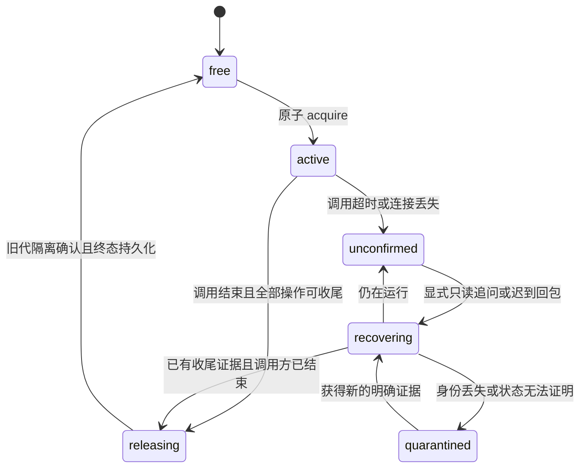

# 租约与超时回执修改方案

状态：**待评审方案，未实施**。日期：2026-11-27。实现基线：`f5a903d` / 0.14.45。

本方案对应同目录 `brief.md`。用户提供的路径少了 `scholar-search` 一层，实际文件位于本仓库 `work/tasks/2026-11-27-lease-receipt/`。本轮只做代码与协议设计检查，不安装新版本、不访问文献站点、不修改产品实现。

## 结论与最小交付

采用 **浏览器级持久租约 + 宿主强制准入 + 扩展执行隔离 + 显式只读追问**。

1. 继续用现有 `browser.lock` 串行化正常调用；另有持久租约覆盖“调用已返回，但浏览器操作尚未确认结束”的空档。
2. 浏览器状态目录中的持久记录是唯一权威，由宿主协调器经跨进程锁更新。内核与扩展都不另建一套相互竞争的租约真相。
3. 超时不释放未知租约；30 秒只触发诊断/隔离提示，不是自动解锁时间。下一次读取也不能视为放弃上一次。
4. 回执选择 brief 的 **(b) 只读追问**：新增 `navigation_status` 动作和同名 MCP 工具。宿主同时保留迟到的原始动作回包；本批不增加一个动作的多次推送终态。
5. 保持现有 `terminal`、`stage` 枚举；新增原因、发出状态和租约/操作观测字段。`last_job` 仍是 home 级历史结果，不能充当浏览器准入锁。
6. 未确认时禁止新导航和自动重试。零额度查询可用；得到明确终结证据后，也只允许既有批量规则或用户明确请求决定后续动作。

最小可交付必须包含 P0～P3；只有“写租约文件”或“只加 busy 字段”的版本不能启用强制模式。P4 是开启默认强制模式前的发布门。

## 一、基线事实与需要补上的空档

下列工作保留：机器级锁/配额/冷却、home 级文档和缓存、最后一次 goto 的 navigation_id、捕获归属校验、0.14.45 的内核指定 tab_id。私有导航工厂继续返回现有 Action，不要求修改或公开私有补丁。

当前具体空档：

- `core/service.py::_BrowserTransaction.__exit__` 在调用退出时关闭 pinned adapter 并释放文件锁，无法证明扩展异步动作已经收尾。
- `adapters/bridge/host.py::BridgeHost._wait` 超时会移除 `_pending`；reader 只投递给仍在 `_pending` 的 id，迟到原回包会丢失。
- `BridgeAdapter._send` 的 request id 已穿过 TCP/native 两跳，但由适配器临时生成，内核没有一个可在超时后查询的、事先记录的操作身份。
- worker 的异步等待、fallback、`boundTabId` 更新及捕获回调缺少统一的旧代隔离检查。仅有捕获事后比较，无法阻止旧任务后来改变浏览器状态。
- `browser_busy=false` 目前只表示文件锁可取，不表示“没有迟到动作”。

ADR 0030 的“第三片未实施”列表仍包含内核指定 tab_id，已经落后于 0.14.45；P0 需同步文档状态，不重复实现该功能。

## 二、六项问题的决策

### 1. 租约归属、结束与过期

**决策：持久状态为权威，宿主负责原子协调；扩展只持有执行镜像。** 不是把权威放在宿主内存或 worker 全局变量里。

建议增加 `browser_state_dir()/coordination/`：

| 文件 | 用途 |
|---|---|
| `lease.json` | 当前资源代数、当前租约、调用方是否结束、未决操作索引 |
| `lease.lock` | 租约与回执更新的短时跨进程互斥；不同于长业务 browser.lock |
| `operations/<operation_id>.json` | 操作事实及迟到回执；按明确 ID 查询 |

只由宿主的 LeaseStore/reducer 写这些文件，采用锁内重读、校验版本、临时文件原子发布。内核通过已认证 loopback 控制请求访问；不得从 `policy.state_dir` 推导这些路径。home 的 pages、缓存、last_job 不搬家。

宿主若因 Windows 完整性/ACL 无法写入，新功能必须在发动作前明确失败；安装器只处理 coordination 子目录的最小必要权限，不扩大整个 home、pages 或 quota/cooldown 的写权限。

**释放条件全部满足才可变为 free：**

- 调用方已声明本次计划结束，或已核实原调用进程确实终止；
- 所有操作有终结/未发出证据，且旧插件续体不能再导航、改变全局 tab 指针或发布旧捕获；
- 发布已经完成或明确放弃/失败，宿主已持久化收尾记录。

成功读取在发布完成后释放；失败读取在安全收尾后释放。**不等 MCP 响应成功写到客户端**，否则客户端断开会永久占用资源。home 的 best-effort last_job 写失败也不能单独把一个已安全终结的浏览器锁死。

调用超时则先记 `owner_call_finished=true`、操作仍未决，保留租约；后续回执确认旧操作收尾后可自动释放，但不得自动续抓/重新发布旧任务。

**不使用固定秒数强制过期。** 推荐 `reconcile_after=动作 deadline+30s` 只表示应进入恢复诊断；过了这个时间仍可能有迟到导航。进程 PID 需连同启动时间/epoch 核对，PID 存在或复用均不能充当终结证明。

Chrome 官方要求按 worker 可随时终止来设计，全局变量也会随其终止丢失，因此不能用 worker 的 Map 作为唯一租约。[生命周期说明](https://developer.chrome.com/docs/extensions/develop/concepts/service-workers/lifecycle)

### 2. 新任务的强制准入点

**决策：立即拒绝，不增加 `busy` 终态，不在一次同步工具调用里等待旧租约。** 对应 brief 的即时返回方向，使用已有 `terminal=blocked` 表示资源暂不可准入。

强制模式下，顶层浏览器事务非阻塞尝试现有 browser.lock；拿不到就返回明确阻断。拿到后 pin 实际宿主，再原子 acquire 持久租约。元数据锁只保护短事务，不跨浏览器 await 或网络往返持有。

```json
{
  "terminal": "blocked",
  "status": "blocked",
  "stage": "navigate",
  "reason": "lease_held",
  "navigation_issued": false,
  "unconfirmed": false,
  "quota_charged": 0,
  "blocking_operation": {"operation_id": "old-op", "state": "unknown"}
}
```

这里 `unconfirmed=false` 指当前新请求没有发出；旧请求的未知状态在 `blocking_operation` 中，不能混在一个布尔值里。原因也可为 `lease_unconfirmed` / `lease_protocol_unavailable`，均不写风险冷却。

三处必须同时强制：

1. **内核事务入口**：覆盖 page_read，以及 search/detail/detail_many/warm_up/snapshot 等浏览器入口，不只保护 page_read。
2. **宿主每次派发前**：核对当前 lease、代数、绑定资源与操作；旧内核或另一 home 的无租约请求也不能穿过。
3. **扩展每个可产生效果的续体前**：核对租约代数与操作归属；尤其包括 fallback 新建 tab、reload、click、全局 boundTabId/map 更新、capture 回调和成功业务回包。被隔离操作仍须记录/返回按原身份关联的收尾事实，不能因为 fence 过期就把诊断证据也静默丢掉。

纯缓存命中、page2md、题录文本导出无需浏览器租约，可以在浏览器忙时继续。`navigation_status` 和现有 ping/info 走专用只读通道，不排在被它们诊断的 browser.lock 后面。

`_page_stage` 要先识别这些准入原因并映射 navigate，不能让通用的 `status=blocked → wall` 分支把资源占用误报验证码。

### 3. 回执选择与故障恢复

**决策：先做 (b)，吸收原迟到回包作为补充，不做 (c) 多次推送。**

| 方案 | 本批结论 | 原因与兼容性 |
|---|---|---|
| (a) 下一次普通回包夹带 late_navigation | 不选为正确性路径 | 新导航可能先发出，才看到旧回执，时序已经太晚；仅可日后作提示 |
| (b) 独立 navigation_status | **采用** | 能在不导航的前提下按操作 ID 追问，往返有界，旧三层可以明确拒绝而不猜 |
| (c) 异步第二终态帧 | 暂缓 | 需另外处理事件流、重放、订阅游标、断连恢复及旧解析器；现阶段不必为获得收尾事实引入全部复杂度 |

新增 MCP `navigation_status(operation_id)`，service 将其映射为动词参数 `target_operation_id`。每次最多一次 worker 元数据采样，建议动作预算 2000ms、整次诊断上限 2500ms，后者包含端点确认、连接、短锁等待和采样。剩余预算不足就返回已有事实或 unknown，不逐层重新开始计时。无内部无限轮询、无重新 goto、无 HTML/MHTML 字节、无额度。`status()` 保持快速的本地/宿主缓存观测，不隐含一次两秒的浏览器追问。

查询先读宿主持久回执；未决且 peer 支持时，再询问**同一资源**的 worker 操作账本和指定 tab 元数据。诊断必须使用独立连接，不能复用已超时的 socket，也不能重新挑“任意活宿主”。

它使用专用诊断路径，不调用会取得 browser.lock 的普通事务，也不运行会被冷却挡住的普通 Planner。内核与宿主仍验证该动作、目标 operation 和原域名范围；worker 的目标 tab 只能从该 operation 的账本中取得，调用者不能提供任意 tab、URL 或域名。已释放的租约仍可查历史回执，不能要求查询先取得一个新的活动租约。只读诊断可更新内部收尾记录，但没有恢复网页派发或清除冷却的权限。

**迟到原回包的收尾事实必须保留：** `_pending` 超时仅取消同步 waiter，不删除 operation→request 的关联；reader 即使找不到 waiter，也将原 action_result 的身份/结果事实交 LeaseStore 校验、去重、落盘。它仍是原动作的唯一回包，不是新增第二回执协议。绝不拿它填充下一请求的结果。

落盘采用元数据白名单，不能序列化整个 action_result。迟到的 HTML/MHTML、截图、正文、检索结果和带签名 URL 不进入共享回执文件，也不被重新交付为成功结果；只保留 operation、导航身份、发出/收尾状态、错误类别和必要时间等事实。

新增 writer 锁包住完整 native frame 的 header+payload+flush；只锁 `_pending` 字典不能防止原动作与诊断/控制消息的多线程帧写交错。

worker 用 `storage.session` 保存最小操作索引、绑定 tab 与最高代数，用于同一扩展会话的 worker 重建。它不能作为跨重载/重启的真相：扩展禁用、重载、更新及浏览器重启会清掉 session 存储。[storage.session 说明](https://developer.chrome.com/docs/extensions/reference/api/storage)

重连必须带 host_epoch、worker_epoch 与资源身份，先 reconcile，再接受会改变浏览器的新动作。账本丢失返回 unknown，不能把“没找到 operation_id”解释成未发出或已经取消。

宿主重启后可由已核验为同一资源的新实例接续诊断；这不是把原查询转给任意在线实例。执行中的 worker_epoch 改变时，原执行上下文必须退出，不得透明重握手后补发剩余 goto。

### 4. 区分未发出与已发出未确认

**决策：拆分原因，使用三值 `navigation_issued: false | true | null`。**

| 事实 | page_read 回包 | 租约 |
|---|---|---|
| 明确未发出 | no_page / navigation_not_issued / navigate，issued=false，unconfirmed=false | 无其他未决操作时安全收尾 |
| 明确已发出，未得到终结事实 | timeout / navigation_unconfirmed / navigate，issued=true，unconfirmed=true | 保留 |
| 不知道是否发出 | 同上，issued=null | 保留 |
| 旧租约挡住当前新任务 | blocked / lease_held 或 lease_unconfirmed / navigate，issued=false | 不创建第二个活动租约 |

只有“内核未进入 dispatch”“宿主校验失败且未写动作帧”“worker 确认在调用浏览器导航 API 之前被隔离”才可确认 false。TCP/native 写成功只证明发送到某层，不证明浏览器发出；写入部分失败、socket 超时、worker 崩溃及无回执都应为 null，不能按异常字符串猜 false。

worker 先持久化 dispatch 意图，再调用导航 API；意图已写但接受结果未记下时崩溃，仍是 unknown。不能因为暂存状态写着 prepared 就推断安全重放。

本批不改变既有配额退款政策。回包费用必须来自同一操作的实际账本记录；查询与迟到回执不重复计费，不在 unknown 时自动退款或清理配额。

零额度保证针对**准入前被挡住的新任务**。已经准入、在限频等待后才被隔离的动作，若既有 Planner 已预留额度，必须如实报告账本费用；不能为凑 `quota_charged=0` 自动退款。租约检查应在预留前再做一次，派发前仍必须复核。

### 5. 未确认时的重试与人工操作

**决策：未确认期间不允许重试导航，只允许零额度诊断。** `retryable` 不得把它标成可自动重试；批量 skill 必须停止本批浏览器派发，而不是仅跳过一个出版社继续撞租约。

明确未发出，只表示不会复制一次已发出的导航；仍不授权自动重试，不越过任何验证码/登录/403/429 停止规则。明确收尾之后的新任务也不是原动作重放。

人工操作的处理：

- 验证在当前有界等待内清除：沿用已有流程在同一 job 继续捕获，复核 DOI、tab 和最后一次导航 ID。
- 调用已返回后用户才清除：只读 reconcile 可把旧操作记为已落地/安全收尾，解除阻断；不把旧 timeout 事后改成原调用曾经 ok，不自动抓取或发布。
- 用户换到其他页：若归属不能成立则记 external_change/unknown，丢弃旧任务输出；不把“标题变了”当成目标文章已就绪。
- 用户关闭原工具 tab：旧续体不得改用 activeTab/workTab 或再创建 fallback tab。确认旧续体已被隔离且目标不存在后，记录 target_closed 并收尾。
- 无法确认时：保留隔离状态，提示具体 operation_id 与所需人工动作；可让用户关闭**明确识别的工具标签**后再查询，不自动关窗、不重启浏览器、不清空租约文件。

不能只看当前 URL/标题就判定旧操作已终结。Tabs API 的 url 是已提交主框架地址、pendingUrl 是待提交地址；它们是观测事实，不是某个插件操作已经取消的回执。[Tabs API](https://developer.chrome.com/docs/extensions/reference/api/tabs)

### 6. 验收方式

协议的确定性主要由真 worker+假浏览器、真实 framing+假 streams、两个独立进程+隔离目录验证。自然墙只承担有限现场确认，不能作为唯一回归测试。

真实验收仍限制为一次正常读取，以及自然偶发时观察验证/超时；不强迫出现网络超时，不反复访问补样本。0.14.41 的 6.1s 自清不是人工点击样本；0.14.44 的两 goto match 是有效正样本；无网页全文的合法 partial 不能算抓取失败。

## 三、身份、状态机和协议契约

### 标识与唯一来源

| 标识 | 来源与用途 |
|---|---|
| resource_epoch | 宿主协调器持久化的资源代；浏览器状态根仍沿用现有配置，不另拆每 profile 队列 |
| host_epoch / worker_epoch | 每次宿主/worker 实例的身份，避免 PID、tab id 复用被当成同一次执行 |
| lease_id + fence | 宿主在短锁内分配；fence 在同一资源代内单调递增，不用时间戳代替 |
| owner_instance_id / job_id | 内核实例身份与该实例中的任务身份；job_id 在进入浏览器事务前生成，贯穿整次读取及其多个计划 |
| operation_id | 内核在发送每个 Action 前分配，贯穿 TCP/native/worker/回执；不同于每次传输 request id |
| navigation_id | 保留现有 worker 每次 goto 生成的唯一 ID；不是 job_id，也不是租约的一生 |
| tab_id | 首个动作确认后绑定到读取上下文；后续动作不重新选 active tab |

首个 goto 选工作 tab 前可以没有 tab_id，但必须已持有资源租约；worker 在发导航前记录本操作绑定。若首个 goto 超时，不发第二条，按 operation_id 查询绑定，不能退回 activeTab。

正常回包后由统一的 LeaseBoundAdapter/执行上下文在**每次 execute 前**投影身份到动作信封，拿到第一条结果后绑定 tab；所以同一个预先构造的两 goto Plan 也会正确携带绑定。私有补丁继续返回普通 Action，无需加入专用私有协议代码。

该包装器必须显式委托原 adapter 的 domains、info、pin 和 close 能力，保留现有渠道域名收窄与事务 pin 行为；不能只包装 execute 后意外绕掉原来的保护。

0.14.45 的 params.tab_id 保留兼容入口。强制模式由执行上下文生成权威目标；若参数与租约绑定同时出现且不一致，宿主/worker 必须拒绝，不能各自选择一套。warm_up 可在同一资源租约内顺序创建多个保留 tab，各操作分别记录绑定；page_read 则固定一个读取 tab。保留标签的生命周期不因租约结束被关闭。

### 最小动作信封（示意）

```json
{
  "id": "transport-request-id",
  "action": "goto",
  "params": {"url": "https://allowed.example/article"},
  "context": {
    "version": 1,
    "resource_epoch": "resource-epoch",
    "host_epoch": "host-epoch",
    "worker_epoch": "worker-epoch",
    "owner_instance_id": "kernel-instance-id",
    "job_id": "job-id",
    "lease_id": "lease-id",
    "fence": 17,
    "operation_id": "operation-id",
    "tab_id": 123
  }
}
```

context 是单独的闭合 schema，不混入业务 params；未声明键、错误类型、过长字符串、过期代数和身份冲突均在副作用前拒绝。域名仍取 manifest 并经宿主收窄，context 无权扩大它。

同 operation_id 的重复请求只返回已有回执或 pending；**不再执行浏览器 API**。同 ID 但动作/参数投影 hash 不同，按协议冲突拒绝。不能把去重做成“帮它再执行一次”。

### 持久租约状态



不存在“超过 TTL → free”或“下一请求 → free”边。记录损坏不是 free；资源代/文件丢失也不能重置 fence 后直接派发，必须先与存活 worker 核对。新 browser 实例与旧实例的关系不明时进入 recovering。

操作回执用独立小枚举 `prepared | executing | settled | unknown`，再带 `navigation_issued` 三值、`quiescent`、`outcome`、`receipt_seq`。这些不是 page_read 的 terminal 枚举。查询未找到记录时 `known=false/state=unknown/issued=null`，不是未发出。

`quiescent` 意味着旧请求不再可能执行插件导航、fallback、全局指针修改或迟到发布；不是“网页已经没有任何资源请求”。已经交给浏览器的未知导航不能仅因停止了 JS 等待就称作 cancelled。终结判定需操作账本、绑定身份和浏览器事实组合，不能只用 status=complete。

收尾证据至少满足以下一种，并同时满足前述调用方结束与持久化条件：

| 证据组合 | 是否允许释放 |
|---|---|
| worker 明确在导航 API 调用前拒绝，且该操作所有续体已终结 | 是，记 navigation_issued=false |
| 同 epoch 的终结回执证明已发出的导航调用、fallback 链及相关回调均结束；绑定 tab/navigation 对账一致，当前无未完成插件操作 | 是；是否有可发布正文仍由原读取契约判断 |
| 原调用已结束；worker 确认隔离旧代，已发导航的接受结果和落地记录明确，指定 tab 无 pending 导航；迟到输出已放弃 | 是；可收尾原 timeout，但不能续抓或改写其历史终态 |
| 原工具 tab 被确认关闭，旧代已隔离，不再有未知的 fallback tab 或在途创建请求 | 是，记 target_closed；不自动关其他标签 |
| 经资源身份核实，原浏览器实例已退出，且旧链路不再能产生效果 | 是；重新打开浏览器属于新的用户操作，不由恢复程序执行 |
| 只有 URL/标题改变、tab complete、超过 deadline、收到 revoke ack，或只确认 owner/host/worker 进程退出 | 否，仍须核实旧续体和已经交给浏览器的操作 |

正常路径必须由 worker 显式记下“所有在途调用与续体已结束”，不能拿 `reply()` 被执行代替收尾。`lease_sync` 的隔离确认只阻止以后启动副作用，不声称撤销已经发出的浏览器导航。不可证明的分支返回具体缺少的证据，人工关闭明确识别的旧工具 tab 是保守的收尾途径。

正常终态与代数不可被迟到帧重新打开。每个回执有递增序号；旧序号、错误资源代，或属于其他租约的旧 epoch 帧只能存作诊断，不能改写当前租约。原操作在账本中登记的旧 host/worker epoch 回执，可经关联校验后终结**该原操作**，即使当前接收实例已经重启；不能把它套到新实例的另一操作。终结记录建议保留 24h、上限 2000 条，只裁剪已终结项；未决项不按年龄清除，容量异常应阻止新派发并诊断。

### 最小控制面

在现有 token 认证的 loopback 协议增加闭合命令 `lease.acquire`、`lease.finish`；`info` 返回租约摘要。宿主向 worker 增加单请求单应答的 `lease_sync/lease_ack`，仅同步身份/隔离代数，不携带 URL、selector 或脚本。

`lease.finish` 必须匹配 acquire 时的 owner_instance_id、job_id、lease_id 和 fence，只能结束自己的调用；它记录调用方结束，不等于无条件释放，也不能提交“我认为导航已结束”替代 worker/宿主事实。重复 finish 幂等，过期代数拒绝。失联恢复由 reducer 核实身份与进程启动信息，不允许其他 home 伪造 finish 接管。

超时路径会隔离旧插件续体，但已经发出的浏览器导航仍可能未知，租约仍保留。失联恢复也不得只凭 socket 断开就认定调用进程或浏览器已结束。worker 在持久化意图等每个 await 之后，必须重新检查 fence；最后检查与调用导航 API 之间不得再出现可插入隔离消息的 await。

这些是明确的协议扩展，需在 ADR 0030 第三片批准并列出控制命令/帧白名单；不能通过控制面偷运新的浏览器动作。控制 handler 的回放必须证明它不调用 tabs.update/create/reload、pageCapture 或内容脚本。需要浏览器观测的工作只由已声明的 navigation_status 执行。

新增的唯一浏览器动词为 `navigation_status`，参数 `{target_operation_id}`，返回操作账本与指定 tab 的元数据，绝不读取“当前活动页”代替找不到的旧操作。

### 修改落点，禁止只改某一层

| 变更 | 必须同步的文件/位置 |
|---|---|
| navigation_status 动词 | `core/contracts.py::Verb/VERBS`；`core/policy.py::READ_VERBS`；`core/params.py::ALLOWED_KEYS` 与值校验；`adapters/bridge/policy.py::VERBS`；worker `CAPABILITIES` 和 handler；`core/service.py` 计划/spec；对应 fixtures 与跨层测试 |
| 同名 MCP 工具 | `server.py`；service 对外方法与专用诊断 spec；`schemas/tools.json`；`tests/unit/test_tools_json_matches_server.py`、`test_tool_schema_contract.py`、`test_response_budget.py`；相关 skill 和兼容文档 |
| Action.context 与 issued/receipt 字段 | `core/contracts.py` 类型；LeaseBoundAdapter 与 `adapters/bridge/__init__.py::_send`；`native-host/main.py::serve_client`；`adapters/bridge/host.py` framing/reader；worker ingress/reply；验证器与序列化测试 |
| 持久租约/reducer | 新增 `core/leases.py`、`core/receipts.py`；`core/config.py` 显式 coordination 路径；宿主调用；`core/service.py::_BrowserTransaction`；禁止放进 quota 或 home/pages |
| 控制命令和 lease_sync 帧 | 新增 `adapters/bridge/lease_client.py`；native-host 命令分派；BridgeHost 控制请求与 reader；worker hello、控制分派、重连；双方控制 schema/特性声明 |
| 能力协商 | worker hello_ack；BridgeHost.build_info 保存新增 features/epoch；native-host info 转发；BridgeAdapter.info 解析；service preflight；status 字段 |
| 结束及发布保护 | service.read_page/_run/_follow_fulltext/_snapshot_locked/_publish_page，以及所有浏览器入口的公共事务；Planner 继续保留原风控与额度执行 |
| 下游处理 | `skills/scholar-batch-read/SKILL.md`、相关 paper-page/search/detail skill、验收入口及失败账本 schema，按下面终态表更新 |
| 安装与发行 | `native-host/install.ps1` 最小目录权限；extension manifest 新 worker 名；五处同版本+NOTICE/CHANGELOG；release-check committed/artifacts |
| 状态摘要与准入原因 | LeaseStore/ReceiptStore 产出事实；native-host info 转发；`BridgeAdapter.info` 解码；service.status 和 `_page_stage` 解释；`server.py` 与上述 schema/预算测试固定对外字段 |

`host.py` 还需独立的完整帧写锁；`BridgeAdapter` 诊断接口必须 pin 同一资源、另开连接；二者不能只通过改 service 层掩盖。

## 四、回包与下游同步

| 阶段 | terminal/stage 枚举 | 字段/工具变化 | 下游同步 |
|---|---|---|---|
| P0 契约 | 不变 | 只写提案/schema 定义 | 评审确认原因与未知值语义 |
| P1 观测实现 | 不变 | 可选 lease/operation 摘要；内部动词和控制能力声明 | 未完成三层时不得宣称受保护 |
| P2 准入实现 | **不新增枚举** | blocked + lease_held/lease_unconfirmed/lease_protocol_unavailable；context 与 fence；强制模式的 browser_busy 含未终结租约 | 批量遇这些原因整批暂停派发，不自动换组 |
| P3 恢复与公开查询 | **不新增枚举** | navigation_not_issued / navigation_unconfirmed、issued 三值、公开 navigation_status、operation/lease 状态 | 失败账本保存 operation_id/issued/lease_state，诊断不算重试 |
| P4 默认启用 | 不变 | 所有上述字段及能力成为强制模式的必需契约 | 旧字段仍兼容，但不得只看 retryable 或 busy=false |

保留现有 verification_timeout/gate_wait_unavailable、风控与全文部分结果的意义。特别区分：

- `verification_timeout`：既有有界验证等待确实运行；按现有规则处理，不误称导航未确认。
- `navigation_unconfirmed`：旧导航尚未得到终结事实；**整个浏览器资源暂停新派发**。
- `lease_held`：当前新任务未发出，不写 24h 冷却。
- 403/429：仍整批停止并冷却 24h；诊断或租约收尾均无权清掉冷却。

`status.browser_busy` 在强制模式定义为“文件锁占用或存在阻止派发的租约”。新增 `browser_lock_held` 暴露原始锁事实、`browser_lease` 暴露共享资源摘要。`last_job` 保持 home 级调用历史；迟到解决结果通过 operation 记录关联，不把过去已经返回的 timeout 悄悄改成 ok。

公开查询使用诊断回包，不返回一次新的 page_read 终态。例如：

```json
{
  "ok": true,
  "target_operation_id": "old-op",
  "known": true,
  "operation": {
    "state": "settled",
    "navigation_issued": true,
    "quiescent": true,
    "outcome": "landed",
    "tab_id": 123,
    "navigation_id": "last-goto-id",
    "receipt_seq": 3
  },
  "browser_lease": {"state": "free", "admission_blocked": false},
  "quota_charged": 0
}
```

`ok=true` 只表示查询成功，operation 仍可能是 unknown；`outcome=landed` 不表示已抓取或已发布全文。查询自身超时用诊断错误 `diagnostic_timeout`，同时保留最近已知事实，不覆盖旧 job 的 terminal。字段统一使用 `navigation_issued`；正文中的 issued 仅是简称。

lease/operation 共享文件只保存身份、时间、参数摘要和信号，不能包含 Cookie、token、HTML、完整检索文字或带凭据的 URL。完整已授权文献结果仍按 home 返回；跨 home 诊断只给阻断所需最小摘要。

## 五、分阶段实施、灰度与回滚

### P0 · 冻结契约和故障模型

- 文件：本方案、`docs/adr/0030-action-identity-envelope.md` 第三片、`docs/compatibility.md`；起草协议类型和状态转移测试。
- 验证：逐条核对动词/控制帧/字段的生产者与消费者；固定两 goto 的实际 ID 序列作为脱敏正例。
- 灰度：纯文档与离线测试，不影响用户调用。
- 回滚：撤销提案即可，无运行态迁移。不得先把 ADR 标成“已实施”。

### P1 · 持久操作记录、只读查询与迟到原回包

- 文件：新增 LeaseStore/ReceiptStore、路径配置；BridgeHost reader/writer；BridgeAdapter context/诊断连接；native-host 控制分派；worker 操作账本、navigation_status 与 features；安装器最小权限。
- 验证：真实 framing+假 stream，过期 waiter 后原回包仍落在正确 operation；JS VM 证明查询无导航；进程重启后记录可读；发布 wheel 解包后的各层声明一致。
- 灰度：浏览器级 `observe`，只加记录与诊断，明确“不具备强制隔离保证”。同一资源只能有一个全局模式，不能每个 home 自选。
- 回滚：只在无未决记录时关闭观测；保留文件，不删旧回执。该阶段不依赖“删文件重置”。

### P2 · 统一准入与执行隔离

- 文件：公共浏览器事务、LeaseBoundAdapter、service 发布边界；宿主每动作准入；worker 所有副作用入口和续体；共用 tab 解析逻辑。
- 验证：两 home/两进程抢租约；旧 fence 的延迟 callback 无法更新 tab 指针、导航、创建 fallback tab 或发布捕获；所有在线入口被同一 gate 覆盖。
- 灰度：先仅在假浏览器启用 enforce；真实仍 observe。P3 未完成前不得面向用户打开强制模式，以免制造无恢复通道的隔离状态。
- 回滚：已 active/unconfirmed 的记录继续由新协调器看守；不能仅改开关让旧请求闯入。完成收尾后才允许新任务退回 observe。

### P3 · 未确认收尾、公开诊断与下游

- 文件：service 超时出口、server navigation_status、schemas/tools.json、status、batch/read skill、账本与验收脚本；worker 重连/epoch 协调。
- 验证：发前失败、发后丢回、断连、人工清墙、关闭旧 tab；各自终态/issued/租约释放条件明确。只读查询 2.5s 内返回事实或 unknown，不等待 browser.lock。
- 灰度：全链能力具备时按指定专用 profile 小范围 enforce；保持并发 1、现有限频和配额。
- 回滚：先停新派发、只保留诊断，排空/明确终结租约；再降级新任务。不能在 unknown 时更换 IP、重启浏览器或清租约来“恢复”。

### P4 · 故障回放与发布门

- 文件：跨层/宿主/JS/多进程测试，release-check、兼容矩阵、manifest 和发行元数据。
- 验证：下节矩阵全绿；从实际 wheel/tarball 解包检查字段和 handler，而非只检查工作区；提交后 committed 门通过再 tag。
- 灰度：先用现有捕获和假浏览器；真实仅一次正常读取，自然发生时观察验证/迟到情况。记录未遇到的分支，不冒充通过。
- 回滚：必须保留能识别现有租约 schema 的协调器直到排空；老二进制不理解隔离状态时禁止直接接管。运行数据保留用于前向恢复。

## 六、滚动升级的明确边界

保留现有 framing/hello 的 `protocol=1` 含义，增加可选 `features` 版本（例如 lease_control=1、operation_receipts=1）；新控制类型只在 peer 明确宣告后发送。若实现需要改变旧 hello/帧本义，则另升基础协议，不能仍冒充兼容 v1。

| 组合 | fallback |
|---|---|
| 全链新版本且 features 齐全 | 可启用 enforce |
| 新内核 + 旧宿主 | enforce 下发动作前 blocked/lease_protocol_unavailable；不自动选旧行为继续 |
| 新宿主 + 旧扩展 | 不发送未知控制帧或 navigation_status；enforce 拒绝，observe 可明确保留旧功能且无租约保证 |
| 旧内核 + enforce 新宿主 | 缺 lease/context 的动作在宿主拒绝；ping/info 可用 |
| 任一层版本/epoch 不明 | 只保留诊断，旧记录 recovering/quarantined；不把能力空白当支持 |

新代码的状态文件挡不住仍在服务的旧宿主二进制。**启用 enforce 前必须确认同一受控资源没有可继续转发的旧宿主链路**，由明确的端点/实例确认或用户重载完成切换；不能假装支持任意旧宿主并存，也不自动批量杀浏览器。此条件不满足就不能宣称跨 home 强制保证。

MV3 重建保留 session 账本时可恢复核对；扩展重载、更新或浏览器重启导致账本清空时必须以持久 store 和新 epoch 协调。进程退出/port 销毁不是动作撤销回执；Chrome 的 connectNative 确实与 port 生命周期关联，这不等于旧浏览器导航被取消。[Native messaging](https://developer.chrome.com/docs/extensions/develop/concepts/native-messaging)

## 七、必须自动化的验收矩阵

| 用例 | 离线机制 | 核心断言 |
|---|---|---|
| 单 goto 正常收尾 | fixture + 真 worker VM | 一个 tab、一条导航、match、发布后释放 |
| 私有两 goto | 既有真实 ID 序列 + fixture/VM | 第二条为捕获基准，两 operation ID 独立、同 lease/tab；工厂无需改 |
| 第一条 goto 超时 | fixture | 第二条不执行；无自动重放 |
| 明确发送前拒绝 | 假 socket/host validator | issued=false，零浏览器调用 |
| 部分发送/发后断连 | 假 socket/stream | issued=null/true，不能写 not_issued；租约不释放 |
| waiter 超时后迟到原回包 | BridgeHost + 假 streams | 只落旧 operation，不投递新 waiter、不丢记录 |
| 迟到捕获/正文回包 | 假 streams + 隔离文件系统 | 原操作收尾元数据保留；HTML/MHTML/结果字节不落共享回执，不发生迟到发布 |
| 诊断与原请求并发写帧 | 多线程真实 framing | 帧仍完整可解码，响应按各自 ID 关联 |
| 旧代 callback 晚到 | 真 worker VM + 控制时钟 | 导航、fallback 创建、全局 tab 指针、捕获发布副作用均为 0 |
| 同 operation 重复/冲突 | VM + host | 相同请求只一次执行，冲突 payload 被拒 |
| 两 home 同时 acquire | 两独立进程+同协调目录 | 只有一个获租；失败者不花配额；不能复发 F41-02 初始化竞争 |
| search/detail/warm_up/snapshot 插队 | 服务入口参数化 | 同一未决租约挡住所有浏览器入口；纯本地处理不受阻 |
| 只读追问 | 真 worker VM | 不调用导航/刷新/捕获/内容脚本；不扣额度；不等业务锁 |
| worker 终止与重建 | 重建 VM，共享/清空 session 两类 | 保留时对账；丢失时 unknown，不变 free |
| 宿主重启、owner 退出、PID 复用 | 假 epochs+持久 store | 不只按 PID 判断；状态不退回初始空白 |
| 人工清墙晚于调用返回 | 假浏览器事件 | 可收尾放行，不把原 timeout 改 ok、不自动续抓 |
| 人工换页/关闭旧 tab | VM | 不复用 activeTab、不补开 fallback；旧输出拒绝，已安全终结可释放 |
| 文件损坏/权限失败 | 隔离文件系统 | 派发前失败或保持隔离，不 reset 为 free |
| 403/429 与登录/验证 | fixtures | 原风控优先；不清冷却、不靠查询恢复导航 |
| 新旧三层混跑 | 协议矩阵 | 未协商不发新类型；enforce 明确拒绝、无站点副作用 |
| 源码/发行物脱节 | 解包 wheel + 跨层契约 | VERBS、params、CAPABILITIES、features、handler 与 schema 同步 |

复用 `tests/unit/test_wall_early_exit.py` / `tests/js/gate_watch_probe.js` 的真 worker+假浏览器机制，新增 lease/receipt probe；扩展 `test_capability_contract.py`、`test_bridge.py`、`test_native_host_domains.py`、`test_capture_lease.py`，新增多进程 LeaseStore 测试。涉及桥接/准入的 fixture 必须提供运行能力信息，不能通过没有 info() 而跳过关键 gate；纯解析 fixture 不必模拟桥接。JS probe 从 manifest 读取本版 worker 路径，不能把 0.14.45 写死。

真实偶发样本才可确认的部分：实际 Edge 前台/最大化、人工完成验证后的真实页面、实际 host/worker 中断与网络落地时序。无法安全诱发的分支以离线证明为发布必需条件，现场样本缺失应如实列出；不通过反复访问制造 403、验证或超时。

## 最终验收门槛

- 不存在“原调用已返回，所以旧操作必定停止”的判断。
- 不存在“过了 30 秒/下一请求到来，所以可以解锁”的状态边。
- 所有新浏览器任务都经过同一准入，诊断请求能在被诊断任务占用期间工作。
- 两 goto、迟到回包、worker 重建、混版本拒绝均有跨层回放；正反捕获校验都保留。
- 返回给 AI 的每个 reason、issued 和 lease 状态有具体事实来源，缺证据时显式 unknown。
- 未决期间不自动重试、不清风险状态；人工正常清墙后有只读收尾路径，不永久依赖已经死亡的调用方。
- 全部发行物同版本、worker 改名，mypy --strict/ruff/pre-commit/release-check 按仓库规则通过；仅在完成这些门槛后宣称该协议片已实施。
